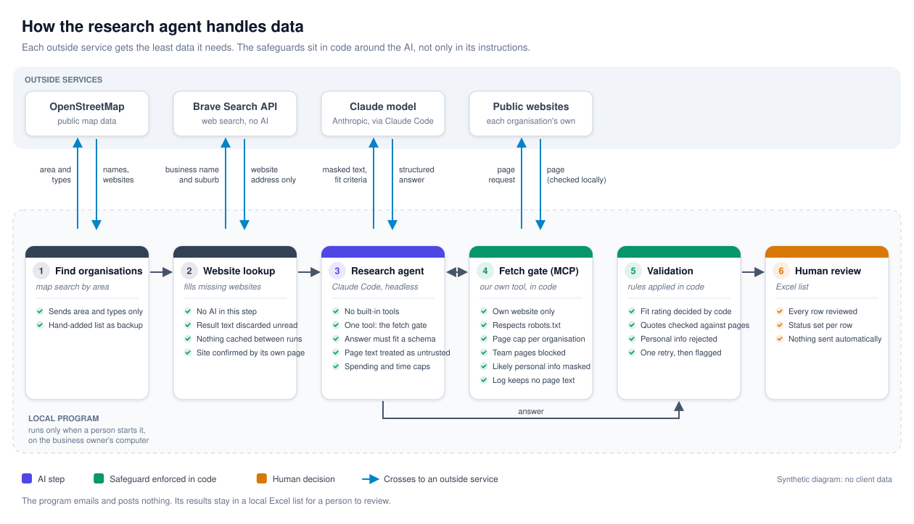

# Org Research Agent

[](https://github.com/kylelhk/org-research-agent/actions/workflows/tests.yml)

A Python program that uses Claude Code in headless mode (`claude -p`) to research local organisations from their public websites and rate how well each fits a business's outreach criteria, with privacy safeguards built into the code around the AI. It was built for a small business in the Victoria Park AI Business Boost program, and designed to be handed over for the owner to run on their own Mac.

This repository holds the general-purpose code only. The client's criteria, prompts, lists, and content stay in git-ignored private files.

## How it works



1. **Find organisations.** The program asks OpenStreetMap for healthcare organisations in the target area, sending only the area and the organisation types.
2. **Look up missing websites.** For organisations without a working website, it searches the business name and suburb with the Brave Search API. No AI is involved, result titles and snippets are discarded unread, and a site is accepted only if its own page names the organisation and the area.
3. **Research each organisation.** Claude Code runs with **no built-in tools at all**. Its only tool is `fetch_page`, an MCP server written for this project, so the agent can choose which pages to read but cannot browse freely, run commands, or touch files.
4. **Gate every page in code.** The fetch tool allows the organisation's own site only, respects robots.txt, caps the pages per organisation, and blocks team and staff pages by address or by heading. Before any text reaches the model, it replaces likely names with `[name]` using a strict allowlist of ordinary words and health terms, masks personal emails and mobile numbers, and drops links whose address may name a person. The request log keeps no page text.
5. **Validate the answer in code.** The agent must answer in a JSON schema. The program then checks the shape again, verifies each quote against the sentences it actually read, rejects anything that looks like personal information, and applies the fit rule itself. A failed check gets one retry, then the row is flagged for a person.
6. **Hand it to a person.** Results go to an Excel list with a status column. Nothing is emailed or posted.

### Design decisions

| Decision | Why |
|---|---|
| Safeguards in code, not only in the prompt | A prompt can be ignored or manipulated by text on a web page; code cannot |
| A custom MCP fetch tool instead of the built-in web fetch | The rules (own site, robots.txt, page cap, blocked pages, masking, logging) are enforced on every request |
| Page text treated as untrusted | Hidden instructions on a page are reported and ignored, tested with fictional clinic pages |
| Fit decided by code from extracted facts | The model extracts; deterministic code decides, so ratings are consistent and auditable |
| "Unknown" over a guess | Staff size comes only from a stated number or an openly stated sign, never from counting names |
| No session records, no cached search results | Less data kept, and Brave's terms do not allow caching results |

### Results so far

- About **7 seconds per organisation** of agent time on a real list of 18 organisations, against the owner's estimate of 20 to 30 minutes each by hand. Her review time per organisation is still to be measured.
- Accepting openly stated signs of several staff turned **4 of the 5 readable organisations** from "unknown" into rated fits, each backed by a verified quote.
- **0 refused requests** on real sites. On the fictional test clinics, the safety checks passed 18 of 18 in the two live runs after the first run found a bug, which was fixed.
- **417 automated tests**, run on every push.

Known limits are listed in [`docs/limitations-and-readiness.docx`](docs/limitations-and-readiness.docx), and the test record is in [`docs/test-evidence/test-record.xlsx`](docs/test-evidence/test-record.xlsx).

## Design goals

- Read each organisation's own website only, with a page cap, and respect robots.txt.
- Take staff size only from a number the website states, such as "our team of eight". Team and staff pages are never passed to the agent, because they list staff by name. Any output containing a name is rejected. Where no number is stated, the settings can accept signs of several staff that a website states openly: practitioners in the plural ("our dentists"), more than one profession, or more than one location. The agent judges these from wording, never by counting names, and the rule is applied in code. A stated number always decides.
- Mark "unknown" or "couldn't read" instead of guessing.
- Give Claude Code one tool only, a custom `fetch_page` MCP tool, instead of the built-in web fetch. The agent chooses which pages to read, but the tool enforces the rules in code: own website only, robots.txt, a page cap, and no team or staff pages. A team page is caught from its address before it is opened, or from its title or main heading after download, when its text is dropped on this computer. Names on the pages it does read, such as staff listed in a menu or a signed letter, are replaced with `[name]` before the text leaves the computer, using the same strict word test as the output check, so some ordinary words are replaced too. Links whose address may name a person are left out of the link list the agent sees. Every request is logged without page content.
- Keep no session records.
- Write results to an Excel file for a human to review.

## Setup

Requires Python 3.11 or newer. The virtual environment lives outside the synced project folder to avoid syncing thousands of files.

```bash
python3 -m venv ~/.venvs/org-research-agent
source ~/.venvs/org-research-agent/bin/activate
pip install -e ".[dev]"
pytest
```

## Private settings

```bash
cp config/settings.example.toml config/settings.private.toml
```

Edit the private copy. It is listed in `.gitignore` and must never be committed.

## Running

```bash
org-research --dry-run      # List the organisations without researching them
org-research --limit 3      # Research the first 3 only
org-research                # Research the full list
org-research --find-websites  # First find missing or broken websites by search
org-research --choose-suburbs # Choose this run's suburbs in a small window
org-research --suburbs "Victoria Park,Bentley"  # Or name them on the command line
```

**Choosing suburbs.** The settings file lists the usual suburbs and one map centre for them. With `--choose-suburbs`, a small window shows a tickbox for each usual suburb (all ticked) and an Others box for more, separated by commas. Typed names are tidied first: case, full stops, and spaces don't matter, short forms such as St, Saint, Mt, Nth, E, and Vic are read as the official name ("mt. lawley" becomes Mount Lawley), and a state, postcode, or repeat is dropped. Typing more than five suburbs asks first, since each adds its own map search. If the chosen suburbs give more than 40 organisations, the Terminal asks before the website lookup and research start; pressing Return alone stops the run. Organisations are matched by name, so two branches with the same name give one row. Each typed suburb is checked with OpenStreetMap's place search (Nominatim, sending only the suburb name), and must be a suburb of that name inside the Perth metropolitan area. A suburb that isn't found can still be used after a warning, but has no map search of its own; typing a suburb that already has a tickbox asks the user to use the tickbox instead. The chosen suburbs become the run's area for the suburb checks, the website search, and the map search: the usual centre when every usual suburb is ticked, otherwise a search around each chosen suburb's own centre, at the same radius. The hand-added list and the nearby suburbs belong to the usual area, so they are left out when no usual suburb is ticked. The chosen suburbs are shown in the spreadsheet's subtitle. The research guidance in the private settings can say `{suburbs}` where the suburbs belong, such as "in or near {suburbs}", and each run fills in its own suburbs, so the AI isn't told to prefer suburbs the run doesn't cover. If the guidance names the usual suburbs instead, a run with other suburbs prints a note suggesting the placeholder.

The map search often fails once and then works, so it is tried up to three times.

On a Mac, the `launchers` folder has three double-click files for the business owner, so no commands need typing:

- **Install or update.command** creates the project's `.venv` with Python 3.11 or newer, preferring one with tkinter for the suburb window (Homebrew's Python leaves it out; python.org's includes it) and rebuilding an existing `.venv` that lacks it, installs the program, and checks for Claude Code, the private settings file, and a saved Brave key (without showing it). It is safe to run again after downloading a new copy.
- **Run research agent.command** opens the suburb window, runs the agent with the website search whenever a Brave key is saved, and opens the results in Excel. Cancel in the window stops without researching anything.
- **Check content.command** asks for a Word file, runs `content-check` on it, and opens the results as a text file saved next to it. If `config/business-phone.private.txt` or `config/disclaimer.private.txt` exists, the business's own number and approved disclaimer are allowed.

All three use the project's `.venv` if there is one.

`--find-websites` fills the biggest gap in the map data: many practices have no website listed, or a mistyped one. Before the agent runs, it searches each such practice's name with the [Brave Search API](https://brave.com/search/api/), keeps only the result addresses (titles and snippets are dropped unread), skips directories and social media, and opens each home page under the fetch tool's rules. A site is accepted only if it names the practice and the local area, and the name is in its title or web address. The agent and its instructions are unchanged, and no page text from this step goes to the AI. It needs an API key in the `BRAVE_API_KEY` environment variable; the Search plan needs a card and includes $5 of free credit a month, about 1,000 searches. Brave's terms do not allow storing or caching search results, so nothing from a search is kept between runs. Each run searches again, about one search per practice without a working website, so results may vary a little from run to run. The only thing kept is each confirmed website address, in the results spreadsheet for review. The version without this step is tagged `v1-map-only`.

Results are saved to `output/research-<date>.xlsx`, with a status column for the reviewer. Each request the agent makes is logged to `runs/<date>/fetch-log.jsonl`, without page content. Both folders are git-ignored. Press Ctrl+C to stop; finished organisations are still saved.

After each organisation, the run reads the new lines of the fetch log. If the agent asked for another website, a staff profile page, or a page robots.txt forbids, the request was refused and the organisation's row says so in the Notes column. If a quote may contain a person's name and the agent cannot fix it on a retry, the quote is removed and the note says why (for example "given name"), without repeating the word. The run summary shows the totals.

Each Excel file also has a **Run info** sheet with the agent's time per organisation, and columns for the reviewer's checking and rework time. Once those are filled in, compare with a baseline:

```bash
baseline-report output/research-<date>.xlsx --baseline-min <baseline minutes per organisation>
```

The method is in [`docs/baseline-comparison-method.docx`](docs/baseline-comparison-method.docx). Known limits and readiness are in [`docs/limitations-and-readiness.docx`](docs/limitations-and-readiness.docx).

## Content tools

```bash
content-pack private/content/first-home --title "First home" --draft 1   # Build a Word review pack from drafts
content-check private/content/first-home                                  # First automated pass, Word packs included
```

A review pack holds the content from one folder in reading order: invitation, guides, emails grouped by topic, then the slide outline, followed by the review notes and source log for reference. The business owner edits it in Word with Track Changes and approves it by email. `content-pack` can match the business's own style with `--font`, `--table-fill`, and `--logo`. `content-check` reads the pack directly once changes are accepted. It fails any mobile number, except the business's own published number given with `--business-phone`. A clean result means ready for human review, not approved. The full review steps are in [`docs/content-review-checklist.docx`](docs/content-review-checklist.docx).

## Project layout

```text
src/org_research_agent/   Package source: agent runner, fetch tool, checks, Excel output, content tools
tests/                    Automated tests
config/                   Example settings (private copies are git-ignored)
launchers/                Double-click files for the business owner's Mac
docs/                     Data-flow diagram, limitations, test record and evidence, handover templates
test-site/                Fictional clinic pages used for live safety tests
```

## Licence

The general code is released under the [MIT Licence](LICENSE). Client criteria, prompts, lists, and content are not part of this repository and are not covered by it.
